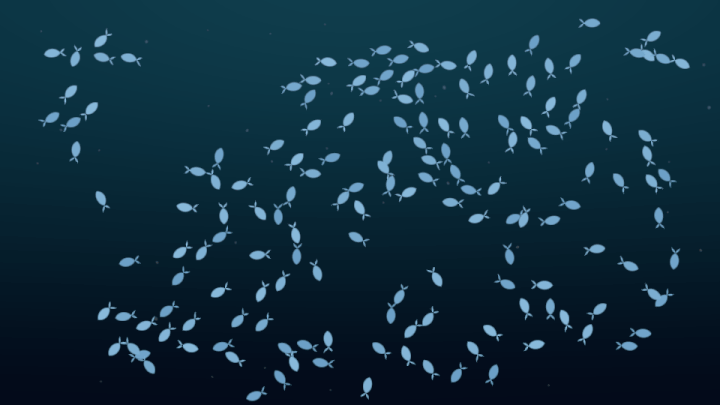

# Living Wallpaper

魚の群泳をデスクトップ背景に表示する、Windows向けの壁紙アプリです。Rust + wgpuで描画し、Boidsによる魚のシーンと、植物を育てるPlantシーンを実装しています。



*現在のシミュレーションとシェーダーで生成したサンプル。160匹・通常速度。GIFは縮小・減色しているため、実際の描画と画質が異なります。*

## 主な機能

- 深海風の背景、ゆっくり沈むマリンスノー、速度に応じた魚の泳ぎ。
- デスクトップアイコンの回避。
- マウス移動時は逃避し、静止10秒後に接近する反応。ON/OFF可能。
- 複数モニターを共有シーンとして表示。隣接する有効な画面間を魚が移動。
- 通知領域から開く設定画面。モニターの製品名で表示先を選択可能。
- FPS制限、シーン全体の時間倍率、省電力制御、設定保存。

## Plantシーン

「シーン」でPlantを選び、カーソルと同じ横位置の画面上部に雲ができ、地面へ雨が降ります。移動中も雲が追従します。雨の下で草・花・木が芽生え、種から周囲の植生も増えていきます。濡れた土は濃い色になり、水分が減ると元の色へ戻ります。

十分な水分と1倍速で、約1分後に双葉が開き始め、3〜5分で本葉のある苗へ育ちます。草花は約1時間、木は約24時間で育ちます。乾燥すると成長は通常の約5%まで遅くなりますが、枯れません。時間倍率は成長と水分消費にも適用されます。

全画面表示で壁紙が隠れていても成長します。FPS=0は描画のみを止め、時間速度=0は成長も止めます。アプリ終了中・Fishを選択している間は成長しません。庭は自動保存し、次回は続きから再開します。「庭をリセット」で、確認後に全モニターの植物・水分・成長状態を初期化できます。リセット後はカーソルを動かすと雨が再開します。プレビューの庭は保存しません。

## 動作環境

Windows 11 x64と、wgpuに対応するGPU・グラフィックスドライバーが必要です。macOSの壁紙連携は未対応です。

## インストール・起動

1. [Releases](../../releases)から `living-wallpaper-windows-x64.zip` をダウンロードします。
2. ZIPを展開し、`living-wallpaper.exe` を起動します。
3. 通知領域の魚アイコンをクリックして設定を開きます。アイコンが見つからない場合は「隠れているインジケーター」内を確認してください。

Release公開後、自動ビルドが成功すると実行用ZIPが添付されます。GitHub標準の「Source code」は実行用ZIPとは異なります。

設定変更で画面は閉じません。右上の×・Escは設定画面だけを閉じ、「終了」は常駐アプリを終了します。終了すると通常のWindows壁紙に戻ります。元の壁紙設定は変更しません。

## 設定

| 項目 | 内容 |
|---|---|
| シーン | Fish / Plant |
| カーソルに反応 | 移動時の逃避・静止後の接近を切り替え |
| アイコンを避ける | アイコンとラベルの領域を回避 |
| 省エネ | バッテリー時は最大15 FPS。ロック・スリープ・全画面表示に応じて停止 |
| 群れの大きさ | 10〜1000匹、10匹刻み。複数画面では全体の合計 |
| なめらかさ | 0〜120 FPS、15刻み。0で停止 |
| 時間の速さ | 0〜2倍、0.25刻み。0でシーン全体を停止 |
| モニター | 初期状態は全画面ON。画面ごとに表示を切り替え |

スライダーは離したときに反映・保存します。設定は次回起動時にも引き継ぎます。FPSは上限で、実際の描画速度はPCや画面構成により変わります。

モニター配置はWindowsのディスプレイ設定に従います。隣接しない画面へのワープは行いません。全モニターをOFFにしても、通知領域から再び有効にできます。

## ソースからビルド

Rust stableのWindows x64 MSVCツールチェーンと、Visual Studioの「C++によるデスクトップ開発」・Windows SDKを用意してください。SDKのリソースコンパイラーをアイコン埋め込みに使います。

Developer PowerShellで実行します。

```powershell
cargo fmt --check
cargo test --locked
cargo build --release --locked
.\target\release\living-wallpaper.exe --preview
```

通常の壁紙モードは引数なしで起動します。`--preview` は通常ウィンドウでシーンを表示し、アイコン回避・全画面による自動停止は行いません。

公開・再配布用のビルドは次を使います。

```powershell
powershell -File .\build.ps1
```

`build.ps1` はテスト・ビルド・ローカルパスの検査を行い、`dist/` にEXE・README・サンプル・ライセンスをまとめます。既存の `dist/` は別の場所へ保管してから実行してください。GNUでの手順など、詳細はソース内の `docs/codex/development.md` にあります。

## 制約・開発状況

- 壁紙配置はExplorerの内部構造（WorkerW / Progman / 非公開メッセージ `0x052C`）に依存します。Windows更新や環境差によって動作しなくなる可能性があります。
- アイコン回避もExplorerの内部コントロールを利用します。取得に失敗した場合はログへ記録し、シーンの動作を継続します。
- 複数画面は単一の描画領域を使うため、全画面を囲む矩形がGPUの最大テクスチャ寸法を超える構成は未対応です。
- 混在DPI、複数GPU、HDR、画面の接続・切断は実機確認が必要です。全画面検出は代表モニター基準で、検出時は共有シーン全体を停止します。
- 多数のモニターがある場合、設定画面が作業領域に収まらないことがあります。
- Explorer再起動で壁紙ホストが失われた場合はアプリが終了します。Explorer復帰後に起動し直してください。
- macOS連携、自動起動登録、インストーラー、署名は未実装です。

## トラブルシューティング

壁紙に表示されない場合は、まずプレビューモードで起動してください。

```powershell
.\living-wallpaper.exe --preview
```

設定は `%LOCALAPPDATA%\LivingWallpaper\settings.json`、庭は同じフォルダーの `plant-state.json`、ログは `app.log` に保存されます。不具合を報告する際はWindowsのバージョン、画面構成、再現手順を添え、ログに含まれる個人名やパスは伏せてください。

## ライセンス

ソースコードは[MIT License](LICENSE)です。依存ライブラリと同梱フォントの権利・ライセンスは[THIRD_PARTY_NOTICES.md](THIRD_PARTY_NOTICES.md)と `third-party-licenses/` を参照してください。設定画面のZen Kaku Gothic NewはEXEに同梱しており、フォントの追加インストールは不要です。
